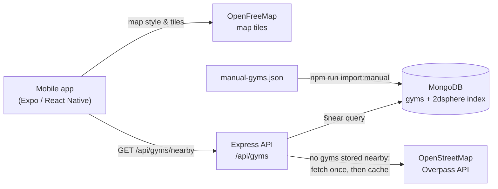

# GymFinder

GymFinder is a mobile app for finding gyms near you. Open it and you see a map of the gyms around your current location, with a swipeable card for each one. You can filter by amenity or price, search by name or city, save favorites, and get directions.

It is built for the Philippines (prices in ₱) and works anywhere that OpenStreetMap has gym data. It is Android-first and runs on iOS through Expo.

## Features

- **Nearby gyms on a map.** The map opens on your location and shows gyms within 15 km, sorted by distance. Pins and cards stay in sync: swipe a card and the map flies to that gym; tap a pin and its card scrolls into view.
- **Map and list views.** Switch between a full-screen map and a full-screen list.
- **Search and filters.** Search by gym name, address, barangay or city. Filter by 24 hours, pool, boxing, yoga or women-only, and cap the monthly or per-session price.
- **Search this area.** Drag the map anywhere and search there.
- **Gym details.** Address, distance, hours, amenities, phone (tap to call), directions in Google Maps, and a link to the source listing.
- **Favorites.** Save gyms on the device. No account needed.
- **Works in new areas automatically.** The first time anyone searches an area, the backend fetches its gyms from OpenStreetMap and stores them. Later searches in that area return instantly.

## Tech stack

| Layer | Technology |
| --- | --- |
| Mobile app | [Expo](https://expo.dev) SDK 58, React Native 0.88, React 19, TypeScript 6 |
| Navigation | React Navigation 7 (bottom tabs + native stack) |
| Map | [MapLibre GL JS](https://maplibre.org) 4 inside `react-native-webview`, with [OpenFreeMap](https://openfreemap.org) vector tiles (no API key needed) |
| Device features | `expo-location` (GPS), AsyncStorage (favorites), `@expo/vector-icons` (Ionicons) |
| HTTP client | Axios |
| Backend API | Node.js 22, Express 5 |
| Database | MongoDB 7 (Docker) or MongoDB Atlas, via Mongoose 8 with a `2dsphere` geospatial index |
| Gym data | OpenStreetMap through the [Overpass API](https://overpass-api.de), plus a hand-curated list in [backend/data/manual-gyms.json](backend/data/manual-gyms.json) |
| Containers | Docker and Docker Compose (backend + MongoDB) |

## How it works



1. The app reads your location and calls `GET /api/gyms/nearby?lat=…&lng=…`.
2. The API runs a MongoDB `$near` query, with your filters, within 15 km.
3. If nothing at all is stored within that radius, the API asks OpenStreetMap for fitness gyms in the area, saves them to MongoDB, and runs the query again. That first request takes 30–60 seconds, because the public Overpass server is slow. Later requests take milliseconds.
4. The map itself is a small MapLibre web page inside a WebView. React Native sends it gyms, selections and re-center commands, and receives pin taps and map moves back.

## Project structure

```text
gym-finder-app/
├── docker-compose.yml          Backend + MongoDB stack
├── backend/                    Express API
│   ├── Dockerfile
│   ├── server.js               App setup, MongoDB connection, error handling
│   ├── routes/gyms.js          /api/gyms endpoints (nearby, search, details, seed)
│   ├── models/Gym.js           Mongoose schema + geospatial index
│   ├── services/overpass.js    OpenStreetMap queries, gym filtering, retries
│   ├── services/seedGyms.js    Saves OSM gyms to MongoDB
│   ├── seed.js                 CLI: import OSM gyms for an area
│   ├── importManualGyms.js     CLI: import data/manual-gyms.json
│   └── data/manual-gyms.json   Curated gyms that are not on OpenStreetMap
└── mobile/                     Expo app
    ├── App.tsx                 Navigation, tab bar, intro screen
    ├── app.json                Expo config (name, icons, splash, permissions)
    └── src/
        ├── screens/            MapScreen, GymDetailScreen, FavoritesScreen
        ├── components/         MapWebView, GymCard, FilterBar, GymBottomSheet, SplashIntro
        ├── hooks/useLocation.ts
        ├── services/           api.ts (backend client), favorites.ts (AsyncStorage)
        └── types/gym.ts
```

## Getting started

### Requirements

- **Node.js 20 or later**, for the mobile app and for running the backend without Docker.
- **Docker Desktop**, for running the backend in Docker. Otherwise you need a MongoDB Atlas database.
- **Expo Go** on an Android or iOS phone, or an Android emulator.

### 1. Configure environment files

```powershell
Copy-Item backend/.env.example backend/.env
Copy-Item mobile/.env.example mobile/.env
```

Then fill in the values (see [Environment variables](#environment-variables)). Never commit either `.env` file; both are in `.gitignore`.

### 2a. Run the backend with Docker (recommended)

```powershell
docker compose up -d --build
```

This starts MongoDB and the API on `http://localhost:5000`. Check it at <http://localhost:5000/health>. MongoDB data is kept in the `mongo-data` volume.

Useful commands:

```powershell
docker compose logs -f backend                                              # follow API logs
docker compose run --rm backend npm run seed -- --lat 11.0064 --lng 124.6075  # pre-load an area from OSM
docker compose run --rm backend npm run import:manual                       # load data/manual-gyms.json
docker compose down                                                         # stop (add -v to delete the database)
```

To use **MongoDB Atlas** instead of the bundled database, create a `.env` file in the project root (next to `docker-compose.yml`) containing `MONGO_URI=<your Atlas connection string>`, then start only the API:

```powershell
docker compose up -d --build --no-deps backend
```

If port 5000 is taken, set `BACKEND_PORT=5050` in that root `.env` file, and use that port in `EXPO_PUBLIC_API_URL`.

### 2b. Run the backend without Docker

```powershell
cd backend
npm install
npm run dev        # nodemon; use `npm start` in production
```

This needs `MONGO_URI` in `backend/.env` pointing at a reachable MongoDB, such as Atlas.

### 3. Run the mobile app

```powershell
cd mobile
npm install
npx expo start -c
```

Scan the QR code with Expo Go. The phone and the computer must be on the **same Wi-Fi network**.

Set `EXPO_PUBLIC_API_URL` in `mobile/.env` to the address the phone uses to reach the backend:

| Where the app runs | `EXPO_PUBLIC_API_URL` |
| --- | --- |
| Physical phone | `http://<your computer's LAN IP>:5000`, for example `http://192.168.1.4:5000` (find it with `ipconfig`) |
| Android emulator | `http://10.0.2.2:5000` |
| Deployed backend | `https://your-api.example.com` |

Restart Expo with `-c` after changing `.env`.

> **Why the mobile app isn't in Docker:** Expo Go loads the app from the Metro dev server over your local network and needs to reach it directly by your computer's IP. Running Metro inside a container on Windows breaks that, as well as the QR code and fast refresh. Use Docker for the backend and run Expo on the host. For production, build the app with [EAS Build](https://docs.expo.dev/build/introduction/).

## Environment variables

### `backend/.env`

| Variable | Required | Description |
| --- | --- | --- |
| `MONGO_URI` | Yes | MongoDB connection string. Docker Compose overrides it to use its own `mongo` service. |
| `PORT` | No | API port. Default `5000`. |
| `SEED_API_KEY` | For `POST /api/gyms/seed` | Shared secret, sent in the `x-seed-key` header. |
| `OVERPASS_URL` | No | Overpass endpoint. Default `https://overpass-api.de/api/interpreter`. |
| `CORS_ORIGIN` | No | Comma-separated list of allowed origins. Empty allows all. |

### `mobile/.env`

| Variable | Description |
| --- | --- |
| `EXPO_PUBLIC_API_URL` | Base URL of the backend (see the table above). It is bundled into the app, so never put secrets here. |

## API reference

Base path: `/api/gyms`. All responses are JSON.

| Method & path | Description |
| --- | --- |
| `GET /health` | Liveness check: `{ "status": "ok" }` |
| `GET /api/gyms/nearby?lat&lng&radius&search&amenity&maxPrice` | Gyms near a point, sorted by distance, each with a `distanceMeters` field. `radius` is in metres (default 15000, maximum 50000). Fetches from OpenStreetMap the first time an area is searched. |
| `GET /api/gyms?search&amenity&maxPrice` | Search all stored gyms by text and filters. |
| `GET /api/gyms/:id` | One gym, by MongoDB id or OSM id (`osm-node-123`). |
| `GET /api/gyms/osm?lat&lng&radius` | Live OpenStreetMap lookup. Nothing is saved. |
| `POST /api/gyms/seed` | Imports OSM gyms around the default area. Requires the `x-seed-key` header. |

`amenity` accepts `24hrs`, `Pool`, `Boxing`, `Yoga` or `Women-only`.

Example:

```bash
curl "http://localhost:5000/api/gyms/nearby?lat=11.0064&lng=124.6075&amenity=Boxing"
```

## Gym data

**OpenStreetMap.** Gyms come from places tagged `leisure=fitness_centre` or `amenity=gym`, plus sports centres whose sport or name indicates fitness. Barangay basketball gymnasiums and covered courts are excluded. OSM rarely includes prices or ratings, so those fields are shown as "not listed".

**Manual listings.** [backend/data/manual-gyms.json](backend/data/manual-gyms.json) holds real gyms that are missing from OSM, such as several in Ormoc City. Each entry includes a `sourceUrl` pointing to its public listing. Pins placed from a street address rather than exact coordinates are marked `locationApproximate: true`, and the app tells users so. To add a gym, add an entry with a real source and run `npm run import:manual`. Re-running is safe, because gyms are matched by name and city. Do not add invented prices, ratings or hours.

**Pre-loading an area** (optional; any area is fetched automatically on its first search):

```powershell
npm run seed -- --lat 11.0064 --lng 124.6075
```

The best way to improve coverage for everyone is to add missing gyms to [OpenStreetMap](https://www.openstreetmap.org).

## Troubleshooting

| Problem | Fix |
| --- | --- |
| Expo Go shows "Something went wrong" and `http://<LAN IP>:8081` does not load in the phone's browser | Your PC's firewall is blocking the phone. On Windows, set the Wi-Fi network to **Private**. If you use a third-party antivirus firewall such as Avast, also allow `node.exe` (and Docker Desktop, if the backend runs in Docker) or mark the network as trusted. |
| The app loads but no gyms appear | Check that `http://<LAN IP>:5000/health` opens on the phone. Check that `EXPO_PUBLIC_API_URL` uses your computer's LAN IP and correct port, then restart with `npx expo start -c`. |
| "Couldn't load gyms" the first time you search an area | The public Overpass server was busy (HTTP 429/502/504). The API retries for about 70 seconds. Tap **Retry** after a moment. |
| Pins in the city centre overlap | Expected when gyms are a few hundred metres apart. Zoom in, or swipe the cards to bring each one to the front. |

## Known limitations

- The app only knows gyms that are on OpenStreetMap or in the manual list, so coverage varies by town.
- OpenStreetMap is fetched only when no gyms are stored within the search radius. An area that overlaps one searched earlier may not fetch its own gyms, and stored areas are never refreshed.
- Favorites are stored on the device only. There are no user accounts or syncing.
- The map loads MapLibre from the unpkg CDN and tiles from OpenFreeMap, so it needs an internet connection.

## Credits and licenses

- Map data © [OpenStreetMap contributors](https://www.openstreetmap.org/copyright), available under the ODbL.
- Map tiles by [OpenFreeMap](https://openfreemap.org). Rendering by [MapLibre GL JS](https://maplibre.org).
- Manual gym listings link to their original public sources in `manual-gyms.json`.
